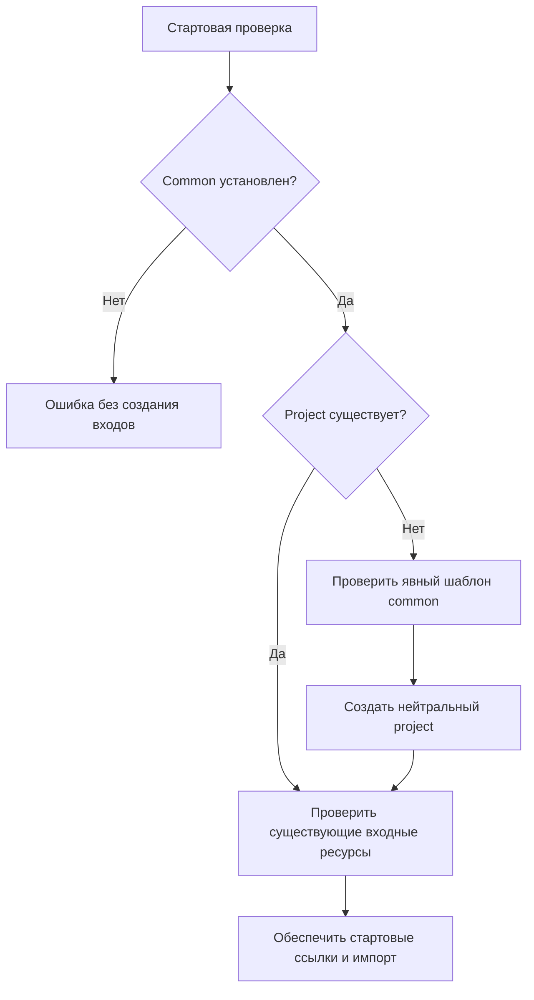

# Two Harness Installation Modes - Plan

## Goal Capsule

- **Objective:** переносить общие знания в новый проект без переноса и ручной очистки материалов прежнего проекта, сохраняя единый полный каркас для новых знаний.
- **Means:** два режима установки и общий явный шаблон проектного каркаса (KTD1, KTD2).
- **Authority:** запрос пользователя и уточнение 2026-10-06; применимые инструкции проекта; этот план. Прежняя независимость project отменяется новым запросом.
- **Execution:** подготовка полного кандидата и доказательств в `harness/common/inbox/2026-10-06-two-installation-modes/`; дальнейший перенос по действующему gate скиллов и правил.
- **Stop conditions:** не менять состав общих проектных категорий без R5; не публиковать непроверенную версию без разрешения на конкретное исключение (R8).
- **Owner:** текущий исполнитель завершает кандидат, проверки и разрешённый перенос. Коммит, push и PR этим планом не требуются.

---
## Product Contract

### Summary

Поддерживаются перенос только common и перенос common вместе с project. В первом случае стартовая проверка создаёт пустой нейтральный project по сохранённому описанию в common. Во втором случае она использует существующий project. Самостоятельный перенос project больше не поддерживается.

### Problem Frame

Перенос проектного дерева в новый проект с последующей очисткой переносит лишние знания и требует ручной работы. Текущий трёхрежимный контракт ещё требует автономного project и не содержит сохраняемого источника пустого каркаса.

### Requirements

**Installation**

- R1. Установка common без project автоматически создаёт полный project при запуске существующей стартовой проверки.
- R2. Созданный project содержит согласованные категории, нейтральные INDEX.md и START.md и человеческие пояснения, без EPL и материалов исходного проекта.
- R3. Установка common+project распознаёт существующий project и не создаёт вместо него пустой каркас; его существующие файлы сохраняются побайтно.
- R4. Project без common считается неподдерживаемой установкой; отсутствие common диагностируется до записи входов и каркаса.

**Template ownership**

- R5. Состав переносимого каркаса задаётся явно в common и изменяется через common inbox только после отдельного явного решения пользователя и отдельного явного подтверждения пользователя. До получения обоих сообщений зависимое изменение останавливается.
- R6. Новые версии описания автоматически используются следующими новыми проектами; папки текущего проекта, включая docs/epl-import/, сами в описание не включаются.

**Contracts and evidence**

- R7. Все действующие инструкции и проверки используют две установки; исторические свидетельства трёх режимов сохраняются как история.
- R8. Применяются действующие границы `harness/common/rules/comm-skill-rule-ownership.md` и `harness/common/rules/comm-user-owned-entrypoints.md`, с новой матрицей из двух режимов.
- R9. Повторный запуск исправной установки не меняет её файлы; небезопасные пути и некорректное описание дают явную ошибку.

### Key Decisions

- **Явный общий шаблон вместо сканирования project.** (session-settled: user-directed — chosen over automatic export of project subfolders: состав общих категорий определяет пользователь.) Governs R5, R6.

### Acceptance Examples

- AE1. Covers R1, R2: в чистый проект перенесён только common; проверка создаёт десять текущих категорий project, нейтральные входные документы и объяснения.
- AE2. Covers R3, R9: перенесены оба пакета с docs/epl-import/ и проектными правилами; запуск и повторный запуск сохраняют эти файлы и не вводят новый пустой каркас.
- AE3. Covers R5, R6: пользователь отдельно решил и отдельно подтвердил добавление specs/ через common inbox; после разрешённого обновления шаблона следующий новый проект получает specs/, а docs/epl-import/ не добавляется.
- AE4. Covers R4: перенесён только project; проверка отказывает и не создаёт common или корневые входы.
- AE5. Covers R5: агент предлагает универсальную папку, ответа или отдельного подтверждения нет; описание не меняется.

### Scope Boundaries

Обновление состава существующих project не выполняется автоматически: R6 относится к следующим новым проектам. Общий шаблон начинается с десяти уже согласованных категорий: base, decisions, lessons, testing, rules, skills, checks, inbox, docs, handoffs. specs служит сценарием будущего изменения, сейчас категория не добавляется.

---
## Planning Contract

### Key Technical Decisions

- KTD1. **Одно декларативное описание в `harness/common/base/project-skeleton.json`.** Список согласованных категорий с назначением и примером позволяет создать INDEX и пояснения без копирования проектных файлов. Governs R2, R5, R6.
- KTD2. **Интеграция в существующий `ensure_entrypoint_links.py`.** Все текущие стартовые вызовы уже проходят через него; отдельная команда установки не нужна. Governs R1, R3, R4, R9.
- KTD3. **Common — единственный источник исполняемой проверки.** Заменить автономную копию `harness/project/checks/ensure_entrypoint_links.py` коротким вызовом обязательной проверки из common для сохранения старых стартовых команд; project START направить на common. В новом пустом каркасе этот совместимый старый путь не создаётся. Project-only остаётся только отрицательным тестом, не третьим режимом. Governs R4, R7.
- KTD4. **Проверить безопасность до записи.** Проверка обычных путей, ресурса шаблона и входов предшествует созданию project; существующий project не ремонтировать содержимым шаблона. Governs R3, R9.

### High-Level Technical Design

### Sequencing

U1 задаёт текущий контракт и кандидат полного скилла. U2 добавляет источник шаблона и автоматическое создание. U3 проверяет оба результата и разрешённый перенос. Поведенческие проверки должны подтверждать текущую итоговую версию, а не прежние hashes.

---
## Implementation Units

### U1. Align live contracts

**Goal:** действующие материалы описывают R1–R8 однозначно.
**Requirements:** R1–R8, AE3, AE5.
**Dependencies:** нет.
**Files:** `harness/common/rules/comm-package-independence.md`, `harness/common/rules/comm-entrypoint-links-rule.md`, `harness/common/START.md`, `harness/common/INDEX.md`, `harness/project/START.md`, `harness/common/docs/compact-authoring.md`, `harness/common/docs/skill-rule-ownership-contract.md`, `harness/common/docs/protected-entrypoints.md`, `harness/common/checks/acceptance.md`, `harness/common/decisions/harness-architecture.md`, `harness/common/lessons/comm-rule-copy-drift.md`, `harness/common/skills/comm-create-lazy-claude-codex-skills/` и соответствующие обычные native copies.
**Approach:** подготовить полный кандидат источников; заменить действующие требования трёх режимов, сохранить исторические свидетельства, кратко закрепить R5 в действующем правиле и указать источник шаблона в процедуре.
**Patterns:** существующий source/native контракт; весь скилл с ресурсами сохраняется в заявке.
**Test scenarios:**
- Covers AE5: инструкция не разрешает менять состав по предположению или молчанию пользователя.
- Ссылки итогового комплекта разрешаются в перенесённой установке.
**Verification:** нет действующего положительного обещания project-only; границы R5 сохранены; native copies соответствуют источникам.

### U2. Bootstrap neutral project

**Goal:** стартовая проверка создаёт проектный каркас только когда project отсутствует.
**Requirements:** R1–R6, R9, AE1–AE4.
**Dependencies:** U1.
**Files:** `harness/common/base/project-skeleton.json`, `harness/common/checks/ensure_entrypoint_links.py`, `harness/project/checks/ensure_entrypoint_links.py` (совместимый вызов common), `harness/common/testing/tests/test_ensure_entrypoint_links.py`, `harness/common/testing/tests/test_entrypoint_portability.py`.
**Approach:** следовать KTD1–KTD4; сохранить API и поведение ремонта стартовых ссылок, выполняя новую проверку common до записи.
**Execution note:** сначала получить исходный отказ сценария AE1, затем проверить итоговое поведение.
**Patterns:** stdlib Python, существующие TemporaryDirectory fixtures и byte-preservation проверки.
**Test scenarios:**
- Covers AE1: перенос только common создаёт полный нейтральный project без доступа к исходному project.
- Covers AE2: существующие проектные файлы и входы не заменяются каркасом.
- Covers AE3: новая согласованная редакция шаблона в изолированном fixture создаёт specs; локальная docs/epl-import не экспортируется.
- Covers AE4: project-only отказывает до записи.
- Повторный запуск не изменяет установленные файлы.
- Повреждённый шаблон, путь с выходом за root, файл или симлинк вместо ожидаемого каталога приводят к отказу без изменения чужих материалов.
- Отсутствующий START в существующем project остаётся диагностируемым повреждением.
- Старая команда AGENTS.md с проектным путём запускается через common при совместной установке и отказывает без common, не меняя текст команды.
**Verification:** установочный запуск из перенесённого common работает автономно и доказательно сохраняет существующий project.

### U3. Validate and publish current candidate

**Goal:** подтвердить новую матрицу и выполнить только разрешённую публикацию.
**Requirements:** R7–R9, AE1–AE5.
**Dependencies:** U1, U2.
**Files:** `harness/common/testing/tests/test_rule_copies.py`, `harness/common/testing/tests/test_entrypoint_notifications.py` (при необходимости адаптации fixtures), `harness/common/checks/check_human_guide_search.py`, `harness/common/inbox/2026-10-06-two-installation-modes/validation.md`, новый итоговый отчёт в `harness/common/checks/`.
**Approach:** обновить действующий human-guide CLI, исключив положительный project-only; два положительных режима и отрицательный контроль project-only; собрать hashes, результаты и независимые статусы агентов; после gate сверить полные обычные копии и текущую установку.
**Patterns:** существующие негативные контроли копий правил; человеческие файлы исключаются из контекста и анализа.
**Test scenarios:**
- Пропуск, изменённая, лишняя или симлинковая native копия правила обнаруживается в обоих поддерживаемых режимах.
- Codex и Claude отдельно выбирают установленный скилл, используют его ресурс и соблюдают R5.
- Непроверенный агент или красная обязательная проверка сохраняет непроверенный итог.
**Verification:** доказательства привязаны к итоговым файлам, публикация соответствует R8, старые свидетельства не подменяют новые проверки.

---
## Verification Contract

- Механические проверки: существующий `python3 -B -m unittest discover -s harness/common/checks -p 'test_*.py'` для кандидата и разрешённой установки; соответствующие assertions покрывают U2/U3.
- Проверка скилла: `skill-creator` quick validator и `plugin-eval start/analyze` для полной итоговой папки, с исключением README.human.md; статическую оценку не выдавать за измеренный расход.
- Переносимость: две чистые установки без исходного project и авторских глобальных материалов; проверить команды, ссылки, пустой каркас, сохранение материалов и повторный запуск.
- Нативное поведение: независимые Codex/Claude статусы для обеих установок. Неуспех, недоступность или пропуск фиксируются как «не проверено».
- Согласование состава: сценарии AE3/AE5 проверяют отдельное решение и отдельное подтверждение; fixture с specs не является изменением действующего шаблона.
- Корневые AGENTS.md/CLAUDE.md не редактируются вне разрешённого восстановления стартовых ссылок.

---
## Definition of Done

Все R1–R9 подтверждены текущими источниками и результатами проверок. Кандидат содержит полные ресурсы и актуальные ordinary native copies. Разрешённый перенос завершён и повторно проверен; если требуется непроверенное исключение, его конкретная область и требуемое разрешение/подтверждение сохранены по применимому gate. Отложенная или неразрешённая публикация не считается выполненным переходом. Экспериментальные реализации удалены; исторические отчёты сохранены.
