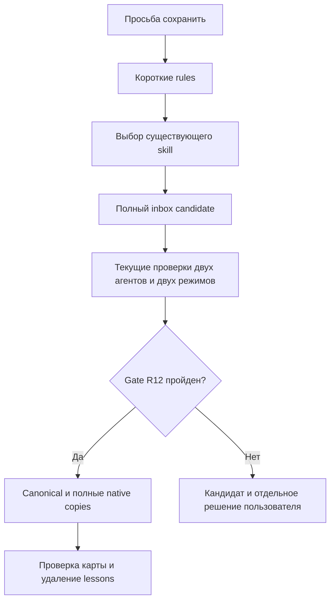

# Skills-first knowledge migration - Plan

## Goal Capsule

**Objective:** Следующий агент по просьбе сохранить опыт выбирает необходимое будущее поведение, находит его рабочую инструкцию и применяет её без потери прежних ограничений.
**Means:** Миграция модели знаний по KTD1–KTD4.
**Authority:** Полный согласованный scope WORKFLOW-48, подтверждение «Убрать lessons; plans оставить в docs/plans — подтверждаю изменение и пользу», применимые канонические границы harness.
**Execution:** Основной исполнитель завершает единую common inbox-заявку, проверки текущей версии и разрешённую публикацию; локальные изменения без незапрошенного Git push/PR.
**Stop conditions:** Не решать за пользователя новый конфликт/развилку или недостающее разрешение по R11. До полного gate R12 не удалять действующие источники и не публиковать миграцию.
**Open blockers:** Вход и чтение источников доступны; запуск реализации не заблокирован. Нативные проверки и gate R12 разрешаются в реализации и не считаются пройденными при планировании.

---

## Product Contract

### Summary

Rules и skills становятся единственными источниками переиспользуемых рабочих инструкций.
Существующие процедуры сохранения опыта получают skills-first выбор, четыре lesson-контракта переходят в подходящие инструкции и свидетельства, категория lessons исчезает после проверенной миграции.

### Problem Frame

Сегодня workflow inbox направляет опыт в lessons, а обязательное правило требует открывать lesson при блокировке.
Рабочие процедуры также остаются в docs и decisions; агенту приходится искать несколько владельцев одного поведения, а изменение папки рискует потерять требования и доказательства.

### Key Decisions

- **Удалить lessons, сохранить планы в docs/plans.** Governs R6, R8. (session-settled: user-approved — chosen over retaining lessons and introducing a top-level plans category: пользователь подтвердил устранение дополнительного источника процедур и пользу единого каркаса.)
- **Развивать существующие процедуры.** Governs R2–R4; отдельный маршрутизатор не нужен.

### Requirements

**Knowledge ownership**

- R1. Переиспользуемые действия находятся в skills и их условно читаемых ресурсах, короткие требования до выбора процедуры — в rules.
- R2. До записи по «сохрани опыт», «зафиксируй решение» и «дополни harness» агент определяет будущее поведение и проверяет существующие skills, rules, ресурсы и исполняемые проверки.
- R3. Существующий материал дополняется при покрытом сценарии; самостоятельная повторяемая компетенция получает компактный lazy skill, а полностью выраженный опыт не создаёт новой записи.
- R4. Skills-first реализуется в `comm-process-harness-inbox` и `comm-create-lazy-claude-codex-skills`, включая обнаружение по description.
- R5. Decisions хранят принятые решения/контракты/инварианты/ограничения и существенные альтернативы, testing/evidence — исходные свидетельства, base — базовые настройки/контракты, specs — формальные спецификации, docs — объяснения/исследования, inbox — временные кандидаты, handoffs — незавершённое состояние.
- R6. Планы остаются в `harness/<package>/docs/plans`; документы, решения, спецификации и отчёты не задают самостоятельные агентские процедуры.

**Migration and preservation**

- R7. Все четыре lesson-контракта сохраняются с краткой картой «требование → новое место → проверка» и прежними доказательствами.
- R8. Lessons исключается из common/project карт, общего каркаса, действующей структуры, переноса, проверок и человеческих пояснений; пустые папки удаляются без нового lessons archive.
- R9. Новый common-only project создаётся без lessons, существующий project меняется только этой адресно разрешённой миграцией и никогда скрыто на обычном старте.
- R10. Обнаружение идёт через name/description, SKILL.md содержит необходимое действие, каждый подробный ресурс имеет конкретное условие чтения.

**Permissions and verification**

- R11. Сохраняются разрешения стадий inbox, условия остановки и исключения однозначных технических исправлений, защита AGENTS/CLAUDE, независимость common/project и исключение README.human.md из агентского контекста.
- R12. Новая версия проходит текущие обязательные проверки отдельно для Codex/Claude и обоих режимов; прежние успехи и разрешение непроверенной публикации другой версии не распространяются на неё.
- R13. Сравниваются стартовый текст и реально прочитанные материалы по сценариям; статический размер не выдаётся за токены фактического запуска или денежную стоимость.
- R14. Canonical и native публикация использует полные обычные копии с равными наборами/байтами, без симлинков и без прямых правок AGENTS.md/CLAUDE.md.
- R15. Для CRLF создаётся отдельный полноценный lazy skill с распознаваемой применимостью и сохранением исправления/регрессий.

### Key Flow

F1. По просьбе сохранить материал агент определяет требуемое будущее поведение, проверяет существующие инструкции, выбирает минимальное изменение, применяет разрешённые стадии inbox и после текущего gate сохраняет результат вне заявки. Covers R1–R5, R10–R12.

### Acceptance Examples

| ID | Input and expected behavior | Covers |
|---|---|---|
| AE1 | «Сохрани повторяемый опыт» → сначала выбор будущего поведения и существующего skill | R2, R4 |
| AE2 | Сценарий уже покрыт → используется/дополняется его инструкция без дубля | R3 |
| AE3 | Независимый сценарий → компактный полный skill-кандидат в inbox | R3, R10 |
| AE4 | Ошибка возможна до выбора процедуры → обязательная граница остаётся коротким rule | R1, R11 |
| AE5 | Посторонняя задача → skill bodies и подробные ресурсы не открываются | R10, R13 |
| AE6 | Новый common-only и существующий combined project → действующие маршруты работают без lessons | R8, R9, R12 |
| AE7 | CRLF/LF входы после узкого ремонта → исходные байты сохранены, следующий запуск без дублей/ложных предупреждений | R7, R15 |
| AE8 | Неуспешная/недоступная текущая нативная проверка → статус не проверено, публикация ждёт отдельного разрешения именно этой версии | R11, R12 |

### Scope Boundaries

Нет нового маршрутизатора, общего framework миграции, watchers/hooks, lessons archive, массовой переработки исторических inbox/отчётов или новых внешних зависимостей.
Исторические команды, старые пути и результаты сохраняются как история по R7; только действующая ссылка на обязательную процедуру считается зависимостью.
Полный CRLF skill входит в scope по R15.

---

## Planning Contract

Product Contract unchanged.

### Key Technical Decisions

- KTD1. **Единый полный кандидат в новой common inbox-заявке.** Сначала сохранить baseline hashes, карту поведения и полные изменяемые файлы; проверять candidate в изолированных установках до canonical/native публикации. Существующий dirty work сохраняется. Governs R7, R11, R12, R14.
- KTD2. **Skills-first в существующих владельцах.** `comm-skill-rule-ownership.md` получает краткую раннюю границу; форма постоянного результата живёт в inbox workflow, преобразование опыта — в авторском skill/resource. Governs R1–R4, R10.
- KTD3. **Перенос procedural частей без нового слоя истории.** Правило хранит обязательную границу блокировки, подробности при необходимости становятся ресурсом inbox skill или отдельным lazy skill для повторяемого permission-blocker workflow. Copy-drift относится к авторству/установке, permission — к inbox workflow, CRLF — к `comm-preserve-text-line-endings`. Существенные основания и raw evidence остаются в dated evidence, полные исходные bytes lessons доступны во временном before и Git. Решения и формальные контракты сохраняют свою роль. Governs R5–R7, R15.
- KTD4. **Каркас меняется данными.** Удалить lessons из `base/project-skeleton.json` и ожидания теста, сохраняя общий алгоритм `ensure_entrypoint_links.py` и wrapper project. Не добавлять startup migration. Governs R8, R9.
- KTD5. **Исторические документы не маскируют регрессии.** Audit делит ссылки на действующие процедуры и исторические наблюдения; исходные evidence не переписываются новым успешным статусом. Governs R6, R7, R12.

### High-Level Technical Design

### Lesson Migration Map

- `2026-10-06-comm-blockers-explicit-permission.md`: операция/факт/источник/существенная ошибка, конкретное разрешение/пути/передача/получатель, ожидание ответа, auto-review отдельно от filesystem отказа, неизменность статусов, техническое исправление в разрешённых пределах → ownership rule и inbox resource; AE4/AE8 и отрицательные permission сценарии.
- `2026-10-05-comm-rule-copy-drift.md`: весь набор comm/proj правил, отсутствие лишних/пропусков, обычные файлы, байты, исключение personal/human, пустая выборка и gate → существующие author/install resources; `test_rule_copies.py` и отдельная нативная проверка.
- `2026-10-05-comm-inbox-explicit-approval.md`: номер варианта не разрешает создание/исполнение, один явный запрос может разрешить оба, предложение сохранить после ошибки не равно разрешению → inbox workflow и короткие permission границы; AE3/AE8 и отдельные stage сценарии.
- `2026-10-05-comm-entrypoint-crlf.md`: UTF-8 без newline normalization, выбор вставки по первому newline каждого файла, CRLF import/Git comparison, сохранение исходных bytes и идемпотентность → CRLF skill/необходимые ресурсы и существующий entrypoint code; AE7 и реальные regression tests.

### Risks and Assumptions

Нативный запуск зависит от текущей доступности CLI/сервисов и разрешений передачи материалов; это execution-time prerequisite R12.
Оценка aggregate harness без реального plugin manifest не является evaluate-plugin: существующий контракт требует честного N/A и отдельных skill/native результатов.
Базовые данные и спецификации сохраняются; после audit удаляется только повторение действий, необходимое условие/инвариант не ослабляется.

---

## Implementation Units

### U1. Stage candidate and preservation map

**Goal:** Зафиксировать полный миграционный кандидат и доказуемое покрытие scope до любых разрушительных действий.
**Requirements:** R5–R7, R11, R12. **Dependencies:** none.
**Files:** Новая dated папка `harness/common/inbox/` с request/full candidate; новая dated папка `harness/common/testing/evidence/` с baseline hashes, существенными основаниями/сырыми evidence и картой; полные исходные bytes только во временном before; действующие `harness/common/{docs,decisions,specs}/` и `harness/project/{docs,decisions,specs}/` для audit.
**Approach:** KTD1/KTD5; разделить procedural и formal/historical части, записать явные разрешения, не трогать прежнюю заявку оптимизации.
**Patterns:** inbox workflow, structure-and-creation-dates, existing evidence.
**Test expectation:** none — inventory не меняет исполняемое поведение; сверка карты и hashes входит в verification.
**Verification:** Все четыре контракта покрыты; исходные bytes доступны во временном before и Git, существенные evidence сохранены; каждый live procedural passage имеет нового владельца.

### U2. Implement skills-first owners and lessons contracts

**Goal:** Направить сохранение опыта к будущему поведению и перенести инструкции в минимальный набор владельцев.
**Requirements:** R1–R4, R6, R7, R10, R11, R15. **Dependencies:** U1.
**Files:** Candidate для `harness/common/rules/comm-skill-rule-ownership.md`; `harness/common/skills/comm-process-harness-inbox/{SKILL.md,references/workflow.md}`; `harness/common/skills/comm-create-lazy-claude-codex-skills/{SKILL.md,references/content-contract.md,references/validation-and-publication.md,references/placement-contract.md}`; `harness/common/skills/comm-install-harness/`; новый `harness/common/skills/comm-preserve-text-line-endings/`; `harness/common/docs/2026-10-05-compact-authoring.md`, `harness/common/docs/2026-10-05-skill-rule-ownership-contract.md`, `harness/common/docs/2026-10-05-protected-entrypoints.md`, `harness/common/docs/2026-10-06-plugin-eval-without-human.md`, `harness/common/decisions/2026-10-05-inbox-execution-status.md`, `harness/common/decisions/2026-10-05-skill-rule-ownership.md`, `harness/common/decisions/2026-10-05-harness-architecture.md`; proposed `harness/common/testing/tests/test_skills_first_knowledge.py`.
**Approach:** KTD2/KTD3; расширить descriptions нужными triggers, оставить формальные контракты и основания в прежних категориях с указателями на владельца поведения.
**Patterns:** existing lazy author/inbox/install skills, skill-creator и writing-skills.
**Execution note:** Сохранить поведенческий baseline до изменения инструкции, затем проверить финальную компактную версию.
**Test scenarios:**

Структурный `test_skills_first_knowledge.py` проверяет только active references/resources/copy integrity; выбор поведения доказывается manual/native наблюдением, не присутствием строк.

1. Covers AE1/AE2. Просьба записать повторяемое существующее решение → выбор и reuse без новой записи.
2. Covers AE3/AE4. Независимая компетенция и обязательная ранняя граница → skill candidate и короткое rule соответственно.
3. Covers AE5. Посторонняя задача → только start guards/metadata, без bodies/resources.
4. Covers AE8. Номер варианта, только создание, создание+выполнение и отсутствующее разрешение публикации → строго разрешённые стадии.
5. Covers AE7. CRLF repair → существующие byte-preservation регрессии остаются неизменны по смыслу.

**Verification:** No live owner зависит от lessons; каждый перенесённый контракт трассируется к R/AE и своему runnable/behavioral check.

### U3. Update structure and two installation modes

**Goal:** Убрать lessons из нового каркаса и текущих действующих карт без скрытых изменений существующих проектов.
**Requirements:** R5, R6, R8, R9, R14. **Dependencies:** U2.
**Files:** Candidate для `harness/common/INDEX.md`, `harness/project/INDEX.md`, `harness/common/base/project-skeleton.json`, `harness/common/specs/2026-10-06-structure-and-creation-dates.md`, applicable install/placement resources, `harness/common/testing/tests/test_ensure_entrypoint_links.py`, `harness/common/checks/check_human_guide_search.py`; affected human guides пишутся без загрузки тел в контекст.
**Approach:** KTD4; текущая подтверждённая смена общего каркаса оформляется отдельным элементом решения новой common заявки. Содержимое существующего project меняется только указанной миграцией.
**Patterns:** `load_project_skeleton`, `test_common_only_creates_neutral_project`, `test_existing_project_is_not_regenerated_or_exported`, `test_new_template_categories_apply_only_to_new_project`.
**Test scenarios:**

1. Covers AE6. Common-only создаёт нейтральный project с agreed categories, без lessons.
2. Existing project с legacy lessons и sentinel files после ordinary startup сохраняет hashes/mtime.
3. Combined installation сохраняет project и повторный startup идемпотентен.
4. Project-only/unsafe resource дают отказ до записи; human-search fixture больше не создаёт lessons как обязательную категорию.

**Verification:** Оба режима и отрицательный project-only control покрыты текущими regressions; сохранились обычные копии и фильтр human.

### U4. Validate final candidate and publish through gate

**Goal:** Получить текущие отдельные статусы и завершить адресную миграцию после проверки сохранности.
**Requirements:** R7, R8, R10–R14. **Dependencies:** U1–U3.
**Files:** Dated evidence/acceptance под `harness/common/testing/`; candidate request/validation; proposed `test_skills_first_knowledge.py`; existing `test_rule_copies.py`, `test_entrypoint_portability.py`, `test_entrypoint_notifications.py`, `test_plugin_eval_without_human.py`; canonical/native destinations и освобождённые `harness/{common,project}/lessons/` после gate.
**Approach:** KTD1/KTD5 и R12; повторить final current checks после последней правки, сверить карту, сохранить raw outcomes. Затем source/copies публикуются вместе по placement, live ссылки проверяются и исходные lessons удаляются только при полном покрытии.
**Patterns:** author validation/publication contract, separate human Node filter, installed evaluate-skill/evaluate-plugin и context-engineering; переиспользовать `native_probe.py`/`run_native.py` прежней `2026-10-07-lazy-context-routing` заявки, не её результаты.
**Test scenarios:**

1. Covers AE1–AE8. Каждый agent/mode выполняет implicit selection, explicit own-resource invocation, unrelated non-loading и preserved permission behavior.
2. Полные sets/bytes/resources canonical/native равны; missing/extra/symlink negative controls остаются красными.
3. После удаления lessons active routes и common-only skeleton работают, historical references не объявляются broken live dependency.
4. Covers AE8. Недоступный/failed режим остаётся not verified; только отдельное разрешение этой версии снимает publication stop, не повышая статуса.

**Verification:** Условия R12 соблюдены, выполнены нижеуказанные gates, результат вне inbox сохранён, request закрывается только после обязательной работы.

---

## Verification Contract

Проверки выполняет реализация, не планирование.

| Check | Scope | Exit evidence |
|---|---|---|
| `python3 -B harness/common/checks/ensure_entrypoint_links.py` | Текущий repo и clean temp installations | Успех/идемпотентность, защищённые входы неизменны |
| `.venv/bin/python -m pytest harness/common/testing/tests` | Current regressions и minimal knowledge check | Текущие результаты, включая CRLF/copies/two modes/negative controls |
| `python3 -B harness/common/checks/check_human_guide_search.py harness/common/rules/comm-human-folder-guides.md --mode common --output <dated-evidence.json>`; повторить с `--mode both` | Human context boundary | Только пути/ошибки/итог, human bodies не загружаются |
| skill-creator final validator | Изменённые/new SKILL.md | Валидный current candidate, не native proof |
| evaluate-skill | Changed skills с human-filter loader | Сценарные discovery/content/behavior результаты текущей версии |
| evaluate-plugin | Только реальный manifest | Actual plugin run либо N/A с причиной, без искусственного manifest |
| Native Codex × common-only/combined | Полный final candidate | listing, explicit resources, implicit triggers, unrelated tasks, read traces |
| Native Claude × common-only/combined | Та же версия | Отдельные результаты, без вывода native success из equality |
| Context comparison | Start/save/reuse/new-skill/CRLF/unrelated scenarios | Baseline/final старт и реальные loaded files/usage с ограничениями R13 |
| Preservation audit | Four lesson contracts, procedural docs, final source/copies | Hashes/raw evidence и покрытие карты до удаления |

`release:validate` не применяется: scope не публикует package release и не содержит такого repo gate.
При отсутствующем инструменте фиксируется not-run с причиной по R12, зависимости не устанавливаются в обход uv.

---

## Definition of Done

- U1: Карта и исходные bytes/evidence позволяют проверить каждый перенесённый контракт после удаления временной заявки.
- U2: Все AE имеют владельца в rules/skills и проверку, skills-first обнаруживается по метаданным, CRLF skill полный.
- U3: Новый каркас без lessons, обычный старт не мигрирует существующий project, действующие карты/структура согласованы.
- U4: Gate R12 завершён для текущей версии или отдельно разрешено именно её непроверенное состояние с честными статусами.
- Рабочих зависимостей от lessons нет; освобождённые каталоги удалены только после карты и проверки, существенные основания и raw evidence остались вне inbox.
- Canonical/native sets и bytes полные, исторические свидетельства не переписаны, AGENTS/CLAUDE не изменены.
- Удалён только временный код отвергнутых подходов этой миграции; прежний dirty work сохранён.
