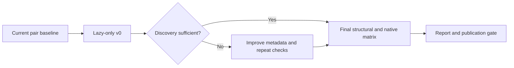

# Verify lazy-only commit policy

## Goal Capsule

Objective: агент сохраняет согласованные границы коммитов при меньшем постоянном контексте, либо получает конкретное обоснование сохранения пары.
Means: изолированное сравнение действующей пары и lazy-only (KTD1).
Authority: scope и разрешение исполнения из текущего чата; действующие common-границы; исходная заявка.
Stop: недостающее разрешение публикации, недоступные обязательные проверки или конфликт результатов не разрешают начало SQL.
Execution: один основной агент, строго последовательные проверки; без субагентов, изменения модели и отправки PR.

## Product Contract

### Summary

Проверить форму первой пары и подготовить решение с воспроизводимыми свидетельствами.

### Problem Frame

Постоянное правило может дублировать выбор контекстной процедуры, но его удаление без проверки способно вернуть лишние коммиты и позднюю загрузку скилла.

### Requirements

- R1. Сохранить весь контракт исходных правила и скилла, включая внешние workflows, исключения, ownership и запреты расширения разрешений.
- R2. Проверить discovery без подсказки удаляемого правила, фактические границы коммитов, явный вызов и отсутствие загрузки в посторонних задачах.
- R3. Отдельно проверить Codex/Claude и common-only/common+project; недоступность не подменять успехом.
- R4. Не менять canonical/native инструкции до разрешённой публикации; сохранять raw-свидетельства и исходный v0 неизменными.
- R5. SQL остаётся в очереди до завершения первой пары, включая публикацию либо явно согласованное закрытие.

### Scope Boundaries

Активна только первая пара из origin. Конфигурация, готовность запуска, project, защищённые входы, общий skeleton и чужие изменения исключены. Установка инструментов и реальные коммиты в рабочем проекте не разрешены. Коммиты в одноразовых acceptance-репозиториях входят в нативный эксперимент.

## Planning Contract

### Key Technical Decisions

- KTD1. Сначала сравнить действующую пару с неизменённым lazy-скиллом без правила: при достаточном поведении новый текст не нужен. Если выбор пропущен, проверить узкое изменение metadata прежде нового правила.
- KTD2. Переиспользовать изолирующие helpers из harness/common/testing/evidence/2026-10-19-instruction-form-selection/validate.py, но не его параллельный suite и не подсказывающие имя скилла неявные prompts.
- KTD3. Временные копии содержат текущий common и все native-скиллы; combined сохраняет текущий project, common-only создаёт нейтральный project. Исходный workspace и личные каталоги инструкций скрываются от нативных экспериментов.
- KTD4. Проверять реальный Git: число коммитов, список путей, сохранность чужого staged-файла и порядок чтения скилла до первого зависимого действия. Ненадёжную автоматическую эвристику дополнить чтением trace и ответа.
- KTD5. Claude сейчас не авторизован; его матрица останется not-run, если состояние не изменится. Это не блокирует доступные проверки, но не даёт verified или разрешения публикации.

### High-Level Technical Design

## Implementation Units

### U1. Capture comparative behavior

Goal: получить первичные наблюдения до изменения инструкций. Requirements: R1–R4. Dependencies: none.
Files: harness/common/testing/evidence/2026-10-19-sequential-rule-to-lazy-skills/validate.py и новые raw JSON в этой папке.
Approach: один acceptance-run за раз, текущая пара → lazy-only v0; полные source/native-копии во временной установке.
Patterns: existing validate.py для form-selection и validation-runner-v2.py для commit-result-boundaries.
Test scenarios:
- Внешний workflow требует коммит после каждого уточнения одного незавершённого документа: сохраняется итоговый draft, коммитов нет.
- Несколько связанных исправлений одного результата: один завершённый коммит только owned-файла, чужой staged-файл сохранён.
- Явная команда сделать коммит промежуточного результата: один owned-коммит допускается.
- Арифметическая задача: тело скилла не загружается, файловых изменений нет.
Verification: сохранены trace, реальный Git и actual reads; промпты не называют целевой скилл в неявных задачах.

### U2. Prepare final active candidate

Goal: минимальная достаточная форма и полный кандидат первой пары. Requirements: R1–R4. Dependencies: U1.
Files: активный кандидат в harness/common/inbox/2026-10-19-sequential-rule-to-lazy-skills и постоянные coverage/form-choice записи в evidence.
Approach: reuse v0 при достаточном выборе; только подтверждённый пропуск допускает изменение metadata и полный повтор обязательных проверок новой версии.
Test scenarios: сохранён каждый исходный контракт; исходный снимок не меняется; rule-only признан недостаточным при отсутствии самостоятельного алгоритма и рабочей ссылки.
Verification: сопоставление требований, quick_validate, plugin-eval start/analyze/compare, анализ JSON brief и актуальные actual reads.

### U3. Validate and report first-stage result

Goal: точный результат первой пары и остановка перед недостающим разрешением. Requirements: R2–R5. Dependencies: U2.
Files: отчёт и манифест версии в evidence; Execution исходной заявки.
Approach: final candidate × оба режима; complete native discovery/explicit/implicit/unrelated, structural installs, повторный старт, отказ project-only и full regression. Сохранить текущие статусы агентов отдельно.
Test scenarios: отсутствие canonical-rule оставлено и в native-наборе; повреждение набора правил даёт отказ без записи; repeated startup неизменен; existing project сохранён.
Verification: report перечисляет pass/fail/not-run/N/A, версию, команды, actual reads, ограничения и неизменённые source/native пути.

## Verification Contract

Обязательные владельцы: comm-validate-harness-instructions и comm-install-harness; публикация отдельно через comm-publish-harness-instructions. Основной набор: harness/common/testing/tests через существующий .venv Python и pytest. Нативные результаты читать содержательно, не считать завершение процесса успешным поведением. Доступные ресурсы, guards+metadata и task reads учитывать отдельно. Ни один старый успех не переносится на изменённую версию.

## Definition of Done

Для первой пары подготовлен полный кандидат или обосновано сохранение пары, завершены доступные обязательные проверки, сохранены raw/отчёт и честные статусы. Если для публикации недостаёт разрешения либо подтверждения непроверенной версии, заявка остаётся in progress и SQL не начинается. Завершением всей заявки считается только завершение обеих пар в согласованном порядке. Экспериментальные временные установки не публикуются в canonical/native.
