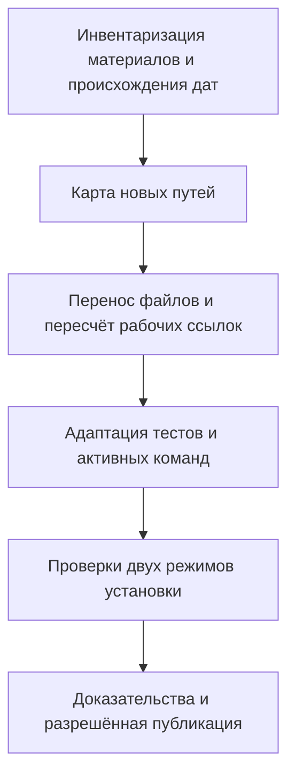

# Harness Structure and Creation Dates - Plan

## Goal Capsule

- **Objective:** пользователь и агенты находят проверки, тесты, отчёты и знания по назначению, а имена материалов остаются стабильными после правок.
- **Means:** одинаковые категории common/project и разовая миграция материалов по KTD1–KTD4.
- **Authority:** последнее уточнение пользователя о датах создания; Requirements этого плана; применимые канонические правила harness.
- **Execution profile:** перенос файлов и адаптация существующих проверок без нового механизма синхронизации.
- **Current authority:** запрос выполнить все заявки разрешает обработку и миграцию; ответ «да» на два отдельных вопроса разрешил предложенный каркас и подтвердил пользу новых папок для всех проектов (R10). Пользователь отдельно подтвердил адресную таблицу старых дат (KTD3); gate публикации итоговых инструкций сохраняется.
- **Stop conditions:** не менять общий каркас до отдельных решения и подтверждения по R10; неизвестную дату старого материала разрешить по KTD3; защищённые входы не редактировать.
- **Delivery:** последующий исполнитель завершает согласованные единицы, сохраняет постоянный результат вне inbox и сообщает реальные статусы проверок. Push/PR этим планом не заказаны.

---

## Product Contract

### Summary

Разделить одинаковую структуру common/project на исполняемые проверки, скрипты, тестовые материалы и знания.
Материалы получают постоянную дату создания в имени; несколько файлов одного материала хранятся вместе.

### Problem Frame

В общем checks/ смешаны команды проверок, pytest-модули, acceptance, launcher plugin-eval и результаты прогонов. Миграция unittest выполнена предшествующей заявкой.
Текущие индексы и каркас описывают десять категорий и не показывают предлагаемое разделение.
Первоначальная автоматическая актуализация дат потребовала бы поддерживать меняющиеся пути; пользователь отказался от неё ради меньшей стоимости сопровождения.

### Key Decisions

- **Дата создания вместо даты обновления.** Пользователь отменил автоматическую актуализацию, чтобы не расходовать токены на неё. Governs R5, R6. (session-settled: user-directed — chosen over automatic last-update renaming: avoid spending tokens maintaining dates.)

### Requirements

**Structure**

- R1. В обоих пакетах присутствуют категории `checks/`, `scripts/`, `testing/`, `specs/`, `docs/`, `decisions/`, `inbox/`, `rules/`, `skills/`, `base/`, `lessons/`, `handoffs/` и стабильные `INDEX.md`/`START.md`.
- R2. `testing/` содержит `acceptance/`, `tests/`, `evidence/`; согласованные категории создаются заранее с `README.human.md` в каждой папке.
- R3. Исполняемые проверки и их инструкции относятся к `checks/`, служебные скрипты — к `scripts/`, тесты/критерии/результаты — к соответствующим подразделам `testing/`.
- R4. Несколько связанных файлов одного evidence, spec, doc или другого материала объединяются в одну предметную папку; примерные подпапки тестов не обязательны.

**Naming**

- R5. Датированные имена материалов в `testing/evidence/`, `specs/`, `docs/`, `decisions/`, `base/`, `lessons/`, `handoffs/` используют `YYYY-MM-DD` как дату создания.
- R6. После изменения содержимого дата в имени файла или папки сохраняется; у папки это дата создания самой папки, независимо от дат вложенных файлов.
- R7. Структурные категории, точки входа, нативные правила/скиллы, исполняемые программы и обязательные служебные ресурсы сохраняют стабильные технические имена.

**Migration and portability**

- R8. Разовая миграция сохраняет содержимое и рабочие ссылки; исторические команды, результаты и hashes не переоформляются как новые доказательства.
- R9. Common остаётся обязательным переносимым пакетом: common-only создаёт нейтральный project, common+project сохраняет существующие материалы, project-only даёт отказ.
- R10. Новый общий состав применяется следующим новым проектам только после отдельных решения и подтверждения полезности для всех проектов по `harness/common/rules/comm-package-independence.md`; миграция текущего project выполняется отдельно.
- R11. Тела `README.human.md` не попадают в агентский контекст и поиск; изменённые правила/скиллы сохраняют действующие проверки и gate публикации с отдельными статусами Codex/Claude.

### Output Structure

Одинаковая схема для `harness/common/` и `harness/project/`:

```text
<package>/
  INDEX.md
  START.md
  checks/
  scripts/
  testing/
    acceptance/
      acceptance.md                 # когда есть собственная матрица
    tests/                          # предметные группы необязательны
    evidence/
      YYYY-MM-DD-single-report.md
      YYYY-MM-DD-report-bundle/
        YYYY-MM-DD-report.md
        YYYY-MM-DD-report.json
  specs/
  docs/
  decisions/
  inbox/
  rules/
  skills/
  base/
  lessons/
  handoffs/
```

`README.human.md` требуется в каждой папке по R2 и в дереве опущен для компактности.
Даты разных файлов и папки bundle могут различаться по R5/R6.
Пустой project получает категории, но не копии рабочих проверок, acceptance или отчётов common.

### Acceptance Examples

- AE1. Covers R5, R6: документ создан 2026-10-06, изменён 2026-10-08; имя остаётся `2026-10-06-<topic>.md`.
- AE2. Covers R4–R6: папка набора создана 2026-10-06, новый JSON добавлен 2026-10-08; папка сохраняет дату 2026-10-06, JSON получает 2026-10-08.
- AE3. Covers R3, R8: тесты перенесены в `testing/tests/`, launcher — в `scripts/`; discovery находит прежние пять модулей, тесты обращаются к настоящим ресурсам в новых местах.
- AE4. Covers R9, R10: новый project получает согласованную редакцию каркаса; уже существующий project не дополняется при обычном старте.

### Scope Boundaries

Автоматическая актуализация дат, watcher, hooks и manifest дат исключены по R6.
Дублирование `check_human_guide_search.py` в tests не требуется: в примере он обозначает возможную организацию, а действующая команда остаётся в checks.
Предметные подпапки `entrypoints`, `package_installation`, `rule_distribution`, `agent_behavior` создавать только при реальной необходимости группировки.
Снимки кандидатов в прежних inbox-заявках не подвергать массовому переносу; это исторические материалы, а не активные пакеты.
Создание новых скиллов, редактирование AGENTS.md/CLAUDE.md и изменение логики plugin-eval не входят в работу.

---

## Planning Contract

### Key Technical Decisions

- KTD1. **Использовать имеющийся генератор каркаса.** `ensure_entrypoint_links.py` уже поддерживает вложенные категории и пояснения промежуточных папок; расширить явный JSON-шаблон после R10, не писать второй генератор.
- KTD2. **Стабильные технические пути отделить от датированных знаний.** По R7 сохранить `base/project-skeleton.json`, `checks/ensure_entrypoint_links.py`, `checks/check_human_guide_search.py`, `scripts/plugin_eval_without_human.mjs`, имена тестовых модулей и `acceptance/acceptance.md`. Это действующие ресурсные/исполняемые контракты, а не датированные записи опыта.
- KTD3. **Дата старых файлов требует происхождения.** Сначала использовать доказуемую дату создания из истории добавления с учётом переименований или явно записанного факта создания. Дата запуска проверки, commit импортированного материала и checkout mtime сами по себе не доказывают создание; при недостоверном происхождении согласовать дату конкретного материала перед его переименованием. Новая папка bundle получает фактическую дату своего создания.
- KTD4. **Выполнить один перенос с картой старых и новых путей.** Рабочие относительные ссылки пересчитать от нового расположения документа, затем обновить активные команды и нативные копии. Исторические transcript/JSON/hashes сохранить как исходные данные по R8; карту и новые проверки сохранить в evidence.
- KTD5. **Плоский каталог tests достаточен.** Он сохраняет простой pytest discovery; у перенесённых тестов адаптировать вычисление пути к checker/launcher в общем месте определения ресурса. Сохранить раздельные запуски исторических редакций через scripts/run_tests.py и обновить корневую pytest.ini вместе с её переносимой копией.

### High-Level Technical Design



После этой миграции правки содержимого не изменяют пути по R6.

### Migration Map

| Сейчас | Предлагаемое назначение |
|---|---|
| `common/checks/acceptance.md` | `common/testing/acceptance/acceptance.md` |
| `common/checks/test_*.py` — пять модулей | `common/testing/tests/` с теми же именами |
| `common/checks/plugin_eval_without_human.mjs` | `common/scripts/plugin_eval_without_human.mjs` |
| `common/checks/check_human_guide_search.py` | Прежний путь, без второй копии |
| `common/checks/*-evidence.md/json` и прочие отчёты | `common/testing/evidence/` с датами по KTD3 |
| `human-guide-search-fix-evidence.md` и `.json` | Одна датированная папка evidence, два отдельных файла |
| `human-folder-rule-compression-evidence.md` и `.json` | Одна датированная папка evidence, два отдельных файла |
| Отчёты без суффикса evidence в `common/checks/` | Классификация по содержимому; результаты прогонов — в evidence |
| `common/docs/agent-loading-evidence.md`, `project/docs/epl-harness-audit.md` | Классификация по содержимому перед переносом; не превращать проектный отчёт в общий |
| Обычные знания в docs/decisions/base/lessons/handoffs | Постоянный префикс создания по R5/KTD3 |
| Существующий `common/docs/plans/` | Не считать автоматически specs; сохранять роль планов |

### Assumptions and Dependencies

Схема категорий согласована как требуемый результат этой заявки; отдельные решение и подтверждение R10 получены ответом «да» на два предложенных вопроса. Кандидат U1/U2 и карта 79 действующих ресурсов с группировкой подготовлены в этой заявке. Даты 48 старых материалов адресно подтверждены пользователем перед переименованием; известные материалы текущего выполнения датированы 2026-10-06.
Операционные исключения KTD2 трактуют даты как именование записей знаний, а не переименование всех JSON/Markdown без разбора.
Для создания дат применяется календарь Europe/Berlin; дата, уже подтверждённая происхождением, не меняется из-за переноса между машинами.
Дополнительные библиотеки не нужны: существующие Python/Node.js-инструменты и pytest в локальной .venv покрывают перенос.

### Execution Blockers

- Для итоговых изменений правил/скилла сохранить gate публикации текущей версии в канонические/нативные каталоги; общий запрос выполнить заявки не повышает их статусы проверки.
- Согласование изменения общего каркаса по R10 получено; оно не отменяет адресное согласование неоднозначных старых дат и gate итоговой публикации.
- Неизвестные даты отдельных исторических файлов разрешаются адресно по KTD3; они не требуют механизма синхронизации.

### Sources and Research

- `harness/common/base/project-skeleton.json`: явные десять текущих категорий.
- `harness/common/checks/ensure_entrypoint_links.py`: `load_project_skeleton`, `create_project_skeleton`, `ensure`; вложенные категории, временная сборка, сохранение существующего project.
- `harness/common/checks/test_ensure_entrypoint_links.py`, `test_entrypoint_notifications.py`: ресурс определяется через `with_name` и должен измениться после переноса теста.
- `harness/common/checks/test_entrypoint_portability.py`, `test_rule_copies.py`: глубина `parents` зависит от положения теста.
- `harness/common/checks/test_plugin_eval_without_human.py`: путь launcher сейчас вычисляется как соседний файл.
- `harness/common/decisions/harness-architecture.md`: прежняя редакция не добавляла specs; новый состав должен быть принят отдельно.
- `harness/common/docs/compact-authoring.md`, `skill-rule-ownership-contract.md`, `plugin-eval-without-human.md`: gate инструкций, ресурсные ссылки, human-guide исключение.

---

## Implementation Units

### U1. Extend the approved category map

**Goal:** индексы и явный каркас описывают согласованную структуру.
**Requirements:** R1, R2, R9, R10.
**Dependencies:** снять gate общего каркаса; затем нет технических предшественников.
**Files:** `harness/common/base/project-skeleton.json`; оба `INDEX.md`; `harness/common/checks/test_ensure_entrypoint_links.py` с последующим переносом в U2; новые категории обоих пакетов и их `README.human.md`.
**Approach:** применить KTD1 к scripts, specs и testing/acceptance, testing/tests, testing/evidence; текущий project дополнять только в рамках разрешённой разовой миграции.
**Patterns:** существующие вложенные fixture specs и `create_project_skeleton`.
**Test scenarios:**

1. Covers AE4: common-only создаёт все категории, нейтральные входы и пояснения вложенных папок.
2. Common+project сохраняет байты пользовательского файла и не добавляет категории при обычном старте.
3. Повторный старт не изменяет созданный каркас; отсутствие common и повреждённый шаблон дают отказ.

**Verification:** новая редакция проходит существующие изолированные сценарии установки.

### U2. Separate executable checks, scripts and tests

**Goal:** проверки и скрипты доступны по назначению, перенесённые тесты запускаются.
**Requirements:** R3, R8, R9.
**Dependencies:** U1.
**Files:** пять текущих `harness/common/checks/test_*.py` → `harness/common/testing/tests/`; launcher → `harness/common/scripts/plugin_eval_without_human.mjs`; acceptance → `harness/common/testing/acceptance/acceptance.md`; активные инструкции команд и ссылки из Sources.
**Approach:** следовать KTD2/KTD5; адаптировать `with_name` и вычисление корня пакета, сохранив один путь ресурса внутри каждого тестового модуля.
**Execution note:** перенос сначала проверить существующими сценариями; функциональность самих checker/launcher не расширять.
**Test scenarios:**

1. Covers AE3: discovery из нового каталога находит все пять прежних модулей.
2. Entrypoint/notification-тесты загружают настоящий common checker после переноса.
3. Portability/rule-copy-тесты выбирают корень нужного пакета/репозитория; launcher-тест обращается к scripts.
4. Native human-search проверка остаётся вызываемой по старому стабильному пути и исключает human guides.

**Verification:** прежние сценарии проходят из новых мест, нет скрытой зависимости от удалённых копий.

### U3. Move and date knowledge artifacts once

**Goal:** знания и отчёты находятся в нужных категориях с постоянными датами создания.
**Requirements:** R4–R8, R11.
**Dependencies:** U1, U2; даты выбранных материалов подтверждены по KTD3.
**Files:** материалы Migration Map; новые датированные папки/файлы в evidence и категориях знаний; затронутые Markdown-ссылки и человеческие пояснения.
**Approach:** составить карту по KTD4, проверить коллизии до переносов, сгруппировать реальные пары отчётов, сохранить сырые доказательства и исторические hashes.
**Test expectation:** нового поведения при редактировании нет; отдельный тест «автоматическое переименование отсутствует» не нужен.
**Verification scenarios:**

1. Covers AE1/AE2: примеры в документации показывают неизменность имени после правки и независимую дату нового вложенного файла.
2. Все рабочие локальные ссылки после переноса разрешаются; ссылки исторического происхождения отмечены как исторические.
3. Пары MD/JSON находятся вместе; каждый отчёт сохраняет принадлежность своему пакету и прежний статус проверки.
4. При совпадении целевых имён перенос не перезаписывает материал; карта сохраняет выбранное разрешение коллизии.

**Verification:** каждый исходный материал учтён в карте, потерь и выдуманных дат нет.

### U4. Publish the consistent contracts and evidence

**Goal:** активные инструкции и нативные копии согласованы с новой структурой.
**Requirements:** R8–R11.
**Dependencies:** U1–U3 и применимые разрешения публикации.
**Files:** затронутые common rules/decisions/START/docs и ссылки скилла; соответствующие обычные копии `.claude/rules/` и разрешённые установленные ресурсы; `harness/common/testing/tests/test_rule_copies.py`; новые evidence/decisions/specs по назначению.
**Approach:** обновить только затронутые контракты; сохранить запрет обхода inbox, human-guide исключение и gate нативных проверок. Сохранить постоянные требования структуры и дат создания вне этой временной заявки.
**Test scenarios:**

1. Обычные копии правил совпадают с каноническими после изменения путей.
2. В каждом режиме установки Codex и Claude находят актуальные ресурсы и соблюдают исключение README.human.md.
3. Отсутствие нативной проверки остаётся «не проверено»; разрешённая непроверенная публикация не повышает статус.

**Verification:** evidence фиксирует текущие версии, фактические результаты и ограничения отдельно от исторических отчётов.

---

## Verification Contract

Это проверки будущей реализации; при подготовке плана они не запускались.

| Проверка | Область | Критерий |
|---|---|---|
| `python3 -B harness/common/checks/ensure_entrypoint_links.py` | U1/U2/U4 | Стартовая проверка успешна, защищённые входы не требуют непредусмотренной правки |
| `.venv/bin/python -m pytest` и `.venv/bin/python harness/common/scripts/run_tests.py` | U1/U2/U4 | Все перенесённые тесты обнаружены и проходят; исторические редакции запускаются отдельно |
| Карта переносов и аудит рабочих ссылок | U3/U4 | Каждый исходный материал сохранён, новые рабочие пути разрешаются |
| Чистые временные common-only и common+project; отрицательный project-only | U1/U2/U4 | Автономность common, нейтральность нового и сохранение существующего project |
| Нативные проверки по существующей acceptance/compact-authoring | U4 | Отдельные наблюдаемые статусы Codex/Claude для итоговых инструкций |

Программные проверки наличия/структуры human guides возвращают только пути, результаты и ошибки по R11.
Новые дату-синхронизирующие программы, сервисы и их тесты не создаются.

---

## Definition of Done

- U1: согласованный каркас и оба индекса отражают R1/R2 с сохранением R9/R10.
- U2: скрипт, acceptance и тесты перенесены; discovery и обращения к ресурсам работают.
- U3: материалы распределены по карте, даты подтверждены, пары сгруппированы, рабочие ссылки исправлены.
- U4: постоянный результат находится вне inbox; инструкции/копии и реальный статус проверки согласованы.
- R6 выполняется без автоматического обслуживания имён; дата создания не заменяется датой изменения.
- Из diff удалены случайные дубликаты, экспериментальные механизмы и неиспользуемые временные ресурсы.
- Статус основной заявки меняется на «выполнена» только после достижения согласованного результата и обязательных проверок/разрешений.
